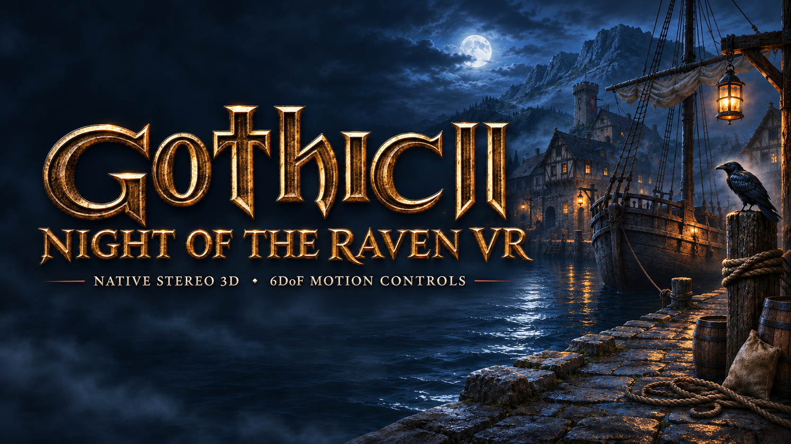
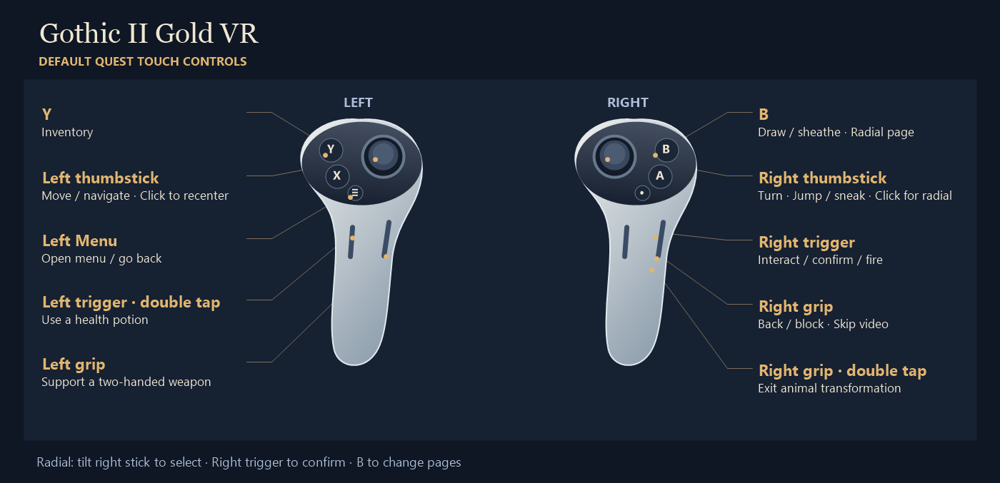

  

# Gothic II Gold VR

Gothic II Gold VR is a PC VR mod by **PeCOS2k5**. It renders Gothic II in native stereo 3D with head tracking and tracked motion controllers. It brings the original campaigns into VR, including their quests, dialogue, combat and progression.

**[Download the official Windows installer](https://github.com/PeCOS2k5/Gothic2GoldVR/releases/latest)** · [Report a bug](https://github.com/PeCOS2k5/Gothic2GoldVR/issues) · [Support the project on Ko-fi](https://ko-fi.com/pecos2k5)

## Campaigns

| Campaign | What you need |
| --- | --- |
| **Gothic II: Night of the Raven** | A local installation of Gothic II Gold Edition. |
| **Gothic II Classic** | Gothic II Gold with the Classic add-on. The launcher checks for the Classic files. |
| **The Chronicles of Myrtana: Archolos** | A separate Archolos installation. English AI voice-over is optional and can be imported from **Mods**. |

[Gothic II Gold on Steam](https://store.steampowered.com/app/39510/) · [Gothic II Gold on GOG](https://www.gog.com/en/game/gothic_2_gold_edition) · [Archolos on Steam](https://store.steampowered.com/app/1467450/) · [Archolos on GOG](https://www.gog.com/en/game/the_chronicles_of_myrtana_archolos)

## Features

- Native stereo 3D with six degrees of freedom for the headset and both controllers.
- Motion-controlled melee, two-handed support grips, bow draw, crossbow aiming, and hand-aimed magic.
- In-headset inventory, journal, dialogue, shops, radial shortcuts, chapter cards, and video playback.
- Smooth or snap turning, walking camera stabilization, a motion vignette, hand calibration, adjustable UI scale and remappable buttons.
- Optional campaign-specific mods in the launcher and an optional PC recording preview for OBS.

## Requirements

- Windows 10 or 11 (64-bit), a PC VR headset, and two tracked controllers. The game uses a 32-bit OpenXR runtime.
- A GPU that supports Direct3D 11 and a CPU with AVX2, required by the supported GD3D11 renderer. Allow enough disk space for a separate copy of each game you prepare.
- An internet connection for the first setup. Setup downloads, verifies, and installs **Union Primary Universal**, **Union 1.0m**, and **GD3D11 17.8 rev. SK9** where needed. [Union downloads](https://worldofplayers.ru/threads/40376/) · [GD3D11 SK9 release](https://github.com/SaiyansKing/GD3D11/releases/tag/v17.8-rev%27SK9)
- A compatible OpenXR runtime. Choose **Virtual Desktop (VDXR)**, **SteamVR**, or **Quest Link / Air Link (SteamVR)** in the launcher. Connect your headset before launching. The Quest Link option uses SteamVR as the OpenXR runtime.

The reference controllers are Meta Quest 3 Touch Plus. The launcher has an OpenXR button mapper for other controllers. Available buttons and axes depend on the controller and runtime.

## Installation

1. Install Gothic II Gold or Archolos through Steam or GOG. Then download and run the Windows installer from the [latest release](https://github.com/PeCOS2k5/Gothic2GoldVR/releases/latest) and choose a destination with room for the VR copies.
2. Click **Install**. Setup detects the installed games, creates their VR copies in `Games`, and downloads and installs the required patches. Approve the Windows prompt for Union if shown. If detection misses your game, use **Locate installed game** to select its folder containing `Data` and `system`.
3. When the launcher opens, select your campaign and **VR Runtime**, then click **Save and Launch**. In the game, look straight ahead and click the **left thumbstick** to recenter.

The original games and their saves stay in place. If you install another campaign later, select it in the launcher and choose **Setup → Prepare VR copy** to copy it and install its requirements. **Repair VR copy** backs up an incomplete copy and transfers its VR saves. Updating or uninstalling the launcher keeps its game copies, settings, and saves. The **Mods** page includes download links for the optional add-ons.

### Upgrade from 1.0

Close the launcher and the game. Run the 1.01 installer in your existing Gothic II VR installation folder and then click **Save and Launch** in the launcher. Your VR game copies, saves, mods and settings are preserved. [Full upgrade instructions](https://github.com/PeCOS2k5/Gothic2GoldVR/releases/tag/v1.01)

## Default Meta Quest 3 controls

Controller illustrations from [Meta Quest Hardware Art](https://developers.meta.com/vr/downloads/package/oculus-controller-art/).

| Input | Default action |
| --- | --- |
| Left thumbstick | Move and strafe. Navigate dialogue, inventory, and menus. |
| Left thumbstick click | Recenter the VR view. |
| Left Menu button | Open the game menu or go back. Left primary (X) is the fallback on profiles without a left Menu input. |
| Y | Open or close inventory. |
| Left trigger, double tap | Use a health potion from inventory. |
| Left grip | Support a two-handed melee weapon or crossbow. |
| Right thumbstick, left/right | Turn. With the radial open, tilt the stick to select a slot. |
| Right thumbstick, up/down | Jump or toggle sneak. While swimming, hold up to surface or down to dive. |
| Right thumbstick click | Open or close the radial. |
| B | Draw or sheathe the weapon. In the radial, change pages. In the loot view, take all. |
| Right trigger | Interact, confirm, or use the equipped ranged weapon or spell. With a bow, hold to grab the string and release to shoot. Also skips the current spoken line. |
| Right grip | Block in melee or go back in a UI. In a video, skip playback. |
| Right grip, double tap | Exit an active animal transformation. |

The radial opens on **Quick slots**. Press **B** for **Actions**, where you can find **Torch** and **Calibrate hands**. Press **B** again for **Mods** when a supported optional plugin is active. For example, Archolos players can open **zFoods** there, turn pages with the left stick, and close it with the right grip. Use **Controls** in the launcher to test and change button assignments.

## Troubleshooting and bug reports

- **Campaign unavailable** — select it in the launcher and check **Setup** for the missing game files or requirements. Prepare or repair the VR copy before launching.
- **Game starts without VR** — check the selected runtime, verify that the headset is connected, and launch the game from **Gothic II VR**. With Quest Link, start SteamVR and select **Quest Link / Air Link (SteamVR)**.
- **An optional mod causes a crash** — disable it in **Mods** and check whether the same save and action still reproduce the crash.
- **Reporting an issue** — include the version, campaign, store edition, headset/controllers, runtime, optional mods, and the steps to reproduce it. Attach `WorldStereoProbe.log` from that VR copy's `system` folder if it helps diagnose the problem. [Open an issue](https://github.com/PeCOS2k5/Gothic2GoldVR/issues/new)

## Credits and official distribution

**Gothic II Gold VR** was created and is maintained by **PeCOS2k5**. Gothic II and Night of the Raven belong to their respective rights holders. Archolos is the work of The Chronicles of Myrtana Team. Thanks to the authors of Union, GD3D11, OpenXR and the optional plugins.

This repository is the official download page for the mod. The Windows installer is listed under **Assets** on the latest release. The project source is private. The installer includes notices for the OpenXR loader.

Copyright © 2026 PeCOS2k5. All rights reserved for Gothic II Gold VR code and original project assets, subject to applicable law and third-party licenses. Please link here when sharing the project. Rehosting or distributing modified builds, or presenting them as your own work or as official releases, requires permission from the maintainer.
